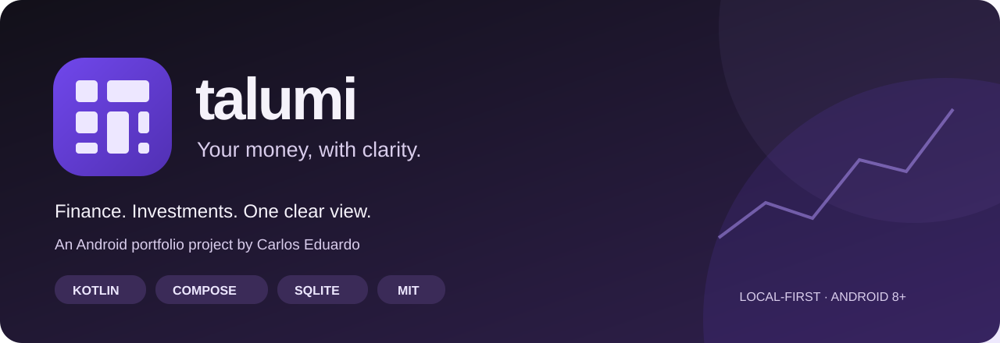

<p align="center"></p>
<p align="center"><strong><a href="README.md">Português</a> · <a href="README.en.md">English</a> · <a href="README.es.md">Español</a></strong></p>
<h1 align="center">Talumi</h1>
<p align="center"><strong>Seu dinheiro, com clareza.</strong><br/>Finanças pessoais e investimentos em um aplicativo Android com dados locais.</p>
<p align="center"><strong>Android 8+</strong> · <strong>Kotlin</strong> · <strong>Jetpack Compose</strong> · <strong>SQLite</strong> · <strong>MIT</strong></p>
<p align="center"><a href="#features">Recursos</a> · <a href="#guide">Como usar</a> · <a href="#development">Executar</a> · <a href="#audit">Auditoria</a> · <a href="#license">Licença e créditos</a></p>

## Novidades da versão 1.4.0

- **Relatórios** com anel animado, resultado mensal no centro, seleção de mês e saídas por categoria. O resultado considera entradas menos saídas confirmadas; transferências e investimentos ficam separados.
- **Informações** ao lado das configurações: tecnologias, privacidade e links para o GitHub e LinkedIn de Carlos Eduardo.
- [Guia da atualização e instalação](docs/ATUALIZACAO-1.4.0.md). A auditoria 1.3.0 abaixo é histórica; veja [a validação desta versão](VALIDACAO.md).

## O projeto

**Talumi** é um organizador de finanças pessoais idealizado e dirigido por **[Carlos Eduardo](https://github.com/C4rlossz)** como projeto de portfólio. Reúne entradas, saídas, salários, compromissos e investimentos, mantendo o dinheiro disponível separado do patrimônio aplicado.

A identidade combina violeta, lavanda e um símbolo inspirado em chip de cartão, com temas claro e escuro. A capa acima é uma ilustração, não uma captura do aplicativo. A interface atual está em português brasileiro; esta documentação também está disponível em inglês e espanhol.

<a id="features"></a>
## ✨ O que você pode organizar

| Área | Funcionalidades |
|---|---|
| **Finanças** | Contas e saldos bancários manuais, carteira, reservas, cofrinhos, entradas, saídas e transferências próprias. |
| **Agenda e salário** | Pagamentos e recebimentos agendados; salário automático por dia fixo ou quinto dia útil; sábados e feriados configuráveis. |
| **Pessoas** | Quem deve a você, suas dívidas, vencimentos e acertos parciais ou totais vinculados a uma conta. |
| **Investimentos** | Carteira separada, pizza por banco, CDB, Tesouro Selic, LCI/LCA, fundos e outras aplicações; aportes, resgates, rendimentos e perdas. |
| **Dados e privacidade** | Backup e restauração JSON, exclusão confirmada, documentos offline e formulários locais de LGPD e acessibilidade. |

### Onde ficam os dados

Os registros financeiros ficam no **SQLite privado do aplicativo**, no aparelho. Não há cadastro, anúncios, analytics, conexão bancária ou Firebase configurado nesta versão. Os saldos são informados por você; o app não movimenta dinheiro real.

A consulta opcional de **CDI e Selic** usa a API pública do Banco Central. Abrir Investimentos busca taxas se ainda não houver consulta salva daquele dia; **Atualizar CDI e Selic** permite uma nova busca. Falhas preservam a última taxa e sua data. A consulta usa parâmetros públicos da série, sem enviar a carteira; o serviço pode receber IP e informações técnicas da conexão. É possível desligar novas consultas nas configurações de privacidade.

<a id="guide"></a>
## 🧭 Como usar

1. **Cadastre suas contas.** Em **Finanças → Contas**, informe banco, carteira, reserva ou cofrinho e o saldo inicial. Exemplo: `1250,50`, sem pontos de milhar. Saldo inicial negativo também é permitido.
2. **Registre os movimentos.** Escolha a conta da entrada ou saída. Transferências próprias não contam como receita ou despesa. Evite repetir movimentos já incluídos no saldo inicial.
3. **Configure o salário.** Em **Agenda → Cadastrar salário recorrente**, escolha valor, conta, início e regra de pagamento. A data de início controla quais meses entram no saldo; não inclua novamente salários já presentes no saldo inicial. Sábados e feriados são informados por você.
4. **Organize compromissos.** Use Agenda para agendamentos e **Pessoas → Registrar acerto** para pagamentos ou recebimentos de dívidas. Cadastrar um compromisso, sozinho, não altera o saldo.
5. **Separe os investimentos.** Use **Investimentos** no topo. Para uma aplicação existente, informe **Valor já investido**. Para aplicar dinheiro das Finanças, crie a aplicação com zero e use **Aportar**. **Resgatar** faz o caminho inverso e respeita o bloqueio de vencimento informado.
6. **Confira rendimentos.** Informe produto e taxa contratada. A previsão é **bruta**, com saldo e taxas constantes, sem impostos, custos ou marcação a mercado. Ela não é creditada automaticamente. Registre o rendimento efetivo conforme o extrato.
7. **Faça backups.** Em Configurações, use **Exportar backup local** e escolha onde salvar o JSON. Para importar, use **Restaurar um backup**. A restauração substitui os registros atuais. O arquivo não é criptografado pelo app.

Atualizações com a mesma identificação e assinatura preservam o banco local. Desinstalar ou limpar o armazenamento apaga os dados: exporte uma cópia antes. Backups exportados são manuais e não se atualizam sozinhos. Destinos em nuvem dependem do provedor selecionado.

O Android pode adiar tarefas de salário em segundo plano; o app reconcilia ocorrências vencidas ao abrir. Projeções de investimento partem da data do saldo de referência: o mês corrente pode mostrar apenas o período restante. Consulte o [guia completo](docs/GUIA-COMPLETO.md) para calendário, histórico e cálculos.

## 🛠 Tecnologias

| Tecnologia | Papel no Talumi |
|---|---|
| **Kotlin 2.1.20** | Modelos, código Android e regras financeiras. |
| **Jetpack Compose / Material 3** | Interface declarativa, temas, formulários e gráficos em Canvas. |
| **SQLite / SQLiteOpenHelper** | Persistência financeira local, transações e migrações. |
| **ViewModel, StateFlow e coroutines** | Estado da interface e operações de disco fora da thread principal. |
| **WorkManager** | Processamento periódico local de salários recorrentes. |
| **HTTPS / API SGS do Banco Central** | Referências públicas de CDI e Selic com cache local. |
| **JUnit, Robolectric e testes Compose** | Regras de cálculo, persistência e fluxos de interface. |
| **Android Lint / Gradle Kotlin DSL** | Análise estática e configuração de build. |

O banco financeiro usa SQLiteOpenHelper. Room aparece como dependência transitiva do WorkManager. Não são necessárias credenciais de nuvem para usar o projeto.

```text
app/src/main/java/com/talumi/financas/
├── MainActivity.kt       # Navegação e identidade visual
├── Forms.kt              # Formulários e confirmações
├── Models.kt             # Valores, saldos e calendário
├── FinanceDb.kt          # SQLite, migrações e backup
├── FinanceViewModel.kt   # Estado e operações serializadas
├── Investments.kt       # Carteira e previsões
├── InvestmentUi.kt      # Interface e gráfico da carteira
├── MonthlyReport.kt     # Monthly report calculations
├── ReportUi.kt          # Animated monthly report
├── AboutUi.kt           # App and author information
├── MarketRates.kt        # Consulta pública de CDI / Selic
├── SalaryWorker.kt       # Recorrências locais
└── LegalUi.kt            # Privacidade e formulários locais
```

<a id="development"></a>
## 🚀 Executar e gerar um APK

**Pré-requisitos:** Android Studio, JDK 17 e SDK Android 35. Compatibilidade mínima: Android 8.0/API 26; target API 35. Gradle Wrapper 8.11.1. A primeira sincronização baixa dependências.

```sh
git clone https://github.com/C4rlossz/Talumi.git
cd Talumi
```

Abra a pasta no Android Studio, aguarde a sincronização e execute em aparelho ou emulador. Para gerar um APK de teste:

**Windows — PowerShell**

```powershell
.\gradlew.bat :app:assembleDebug
.\gradlew.bat :app:testDebugUnitTest :app:lintDebug
```

**Linux / macOS**

```sh
./gradlew :app:assembleDebug
./gradlew :app:testDebugUnitTest :app:lintDebug
```

Saída: `app/build/outputs/apk/debug/app-debug.apk`.

A chave privada de teste não é publicada. Outro ambiente pode gerar uma assinatura debug diferente e não conseguir atualizar uma instalação antiga; veja [assinatura de desenvolvimento](development/README.md). Produção exige configuração e chave próprias. Mantenha keystores, bancos, backups e `local.properties` fora do Git.

<a id="audit"></a>
## 🔎 Auditoria e documentação

A versão **1.3.0** recebeu revisão técnica e documental em **22/10/2026**, solicitada por Carlos Eduardo e executada com assistência de IA. Estes números registram aquela validação, não uma execução contínua de CI.

| Evidência registrada | Resultado |
|---|---|
| Testes automatizados | **61 aprovados**, sem falhas ou ignorados. |
| Android Lint | **0 erros**; 6 avisos de versões mais novas de dependências. |
| Contraste | **47 pares/cenários explícitos medidos e aprovados**, com correções na paleta. |
| Runtime do APK debug | **76 artefatos** inventariados com versões, licenças e hashes. |
| Recursos visuais próprios do app | **3 XML de ícone/composição** inventariados, além dos desenhos procedurais documentados. |

A revisão inclui privacidade, termos, cookies/armazenamento, acessibilidade, autoria, imagens, terceiros e riscos de publicação. **Não é certificação integral LGPD/WCAG, parecer jurídico ou garantia de ausência de vulnerabilidades.** Testes físicos com tecnologias assistivas, operação da caixa de contato e preparação para produção continuam como pendências documentadas.

| Documento | Conteúdo |
|---|---|
| [Relatório da auditoria](docs/auditoria/RELATORIO.md) | Escopo, correções, evidências, riscos e limites. |
| [Validação executada](VALIDACAO.md) | Testes, build, assinatura e verificação do pacote. |
| [Privacidade](docs/PRIVACIDADE.md) · [Termos](docs/TERMOS.md) · [Cookies](docs/COOKIES.md) | Dados locais, conexões públicas, arquivos e condições de uso. |
| [Acessibilidade](docs/ACESSIBILIDADE.md) · [Contraste](docs/auditoria/CONTRASTE.md) | Medidas implementadas, medições e testes manuais pendentes. |
| [Imagens](docs/auditoria/IMAGENS.md) · [Autoria](docs/AUTORIA.md) | Procedência, atribuições e limites de exclusividade. |
| [Dependências](docs/auditoria/DEPENDENCIAS.md) · [SBOM](docs/auditoria/sbom-debug.cdx.json) | Componentes do runtime debug e evidências. |
| [Ferramentas de auditoria](tools/README.md) | Como reproduzir as verificações disponíveis. |

No app, abra **Configurações → Privacidade, acessibilidade e licenças** para documentos offline, formulários, controle das consultas e exclusão confirmada. Os formulários geram TXT para revisão e envio por sua escolha; não enviam mensagens automaticamente.

## 🤝 Contribuir

Sugestões, correções e melhorias são bem-vindas. Leia [CONTRIBUTING.md](CONTRIBUTING.md), abra uma issue para discutir a mudança e envie um pull request com descrição e validação. Use dados fictícios em exemplos e capturas. Para vulnerabilidades ou dados pessoais, use o canal privado em [SECURITY.md](SECURITY.md).

<a id="license"></a>
## 📜 Licença e créditos

**Copyright © 2026 Carlos Eduardo.** As contribuições originais do Talumi estão sob a **[licença MIT](LICENSE)**.

Você pode usar, estudar, modificar, distribuir e utilizar comercialmente o projeto, **mantendo o aviso de copyright de Carlos Eduardo e uma cópia da licença MIT** nas cópias ou partes substanciais do software. Preserve também os avisos aplicáveis aos componentes de terceiros. A licença não exige publicar suas alterações.

AndroidX, Kotlin, Material Icons e outros componentes mantêm seus próprios titulares e licenças; veja [THIRD_PARTY_NOTICES.md](THIRD_PARTY_NOTICES.md) e [LICENSES](LICENSES). O desenvolvimento contou com assistência de IA, registrada na documentação de autoria.

**Responsável pelo projeto:** [Carlos Eduardo — C4rlossz](https://github.com/C4rlossz)  
**Contato público:** [Carlosz.eduardo1402@gmail.com](mailto:Carlosz.eduardo1402@gmail.com)

<p align="center"><strong>Talumi · Seu dinheiro, com clareza.</strong></p>
